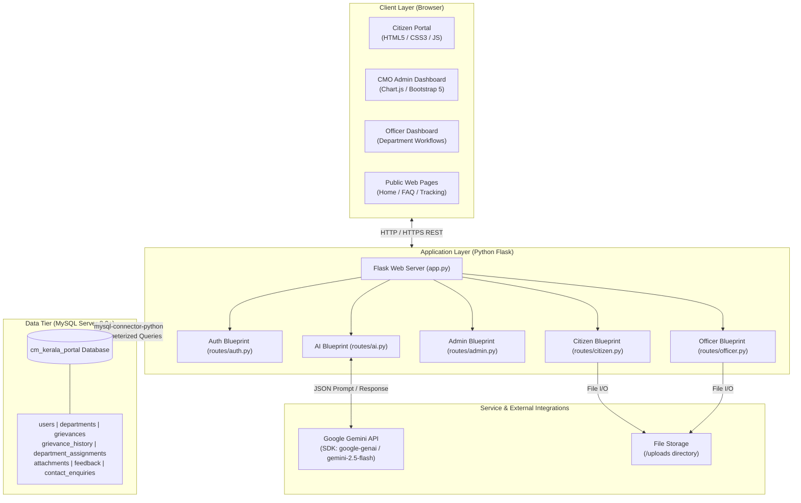
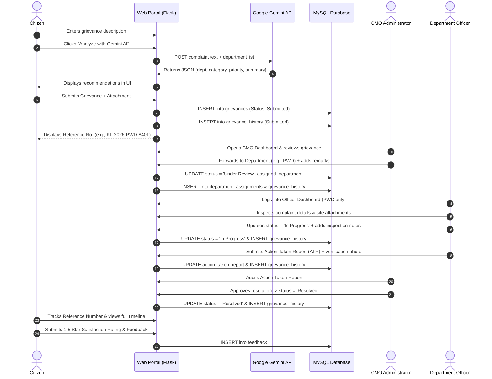

# 02. System Architecture

## CM KERALA – Chief Minister's Public Grievance Redressal Portal

---

## 1. High-Level Architecture Overview
The portal is designed following a clean, modular Multi-Tier Model-View-Controller (MVC) pattern implemented using Python Flask, MySQL, Bootstrap 5, and Google Gemini AI. The architecture prioritizes simplicity, code readability, and security, making it easily explainable in technical interviews while remaining robust and scalable.

---

## 2. Frontend Architecture
- **Templating Engine:** Jinja2 (Flask integrated).
  - `templates/base.html` provides the global layout, security disclaimer banner, responsive navigation bar, flash notification system, and footer.
  - Page-specific templates extend `base.html` to eliminate code redundancy and maintain a consistent UI theme.
- **Styling System:**
  - **Bootstrap 5:** Used strictly for responsive grids (`row`, `col-*`), flexbox utilities, and modal/accordion mechanics.
  - **Custom CSS (`static/css/style.css`):** Defines the Kerala-inspired palette: Deep Green (`#0d5c3a`), Navy Blue (`#13293d`), Subtle Gold Accents (`#c69214`), status badges, and clean card shadows.
- **Interactive JavaScript (`static/js/script.js`):**
  - **Asynchronous AI Triage:** Sends a `fetch()` POST request to `/api/ai/analyze-grievance`, presents real-time loading spinners, displays structured recommendation cards, and provides a one-click button to auto-fill form inputs.
  - **Chart.js Visualizations:** Fetches aggregated MySQL metrics from `/admin/api/chart-stats` and renders responsive Doughnut, Bar, and Horizontal Bar charts without page reloads.

---

## 3. Backend Architecture
The backend is structured into modular Flask Blueprints:
1. `app.py`: Application factory (`create_app()`), Blueprint registrations, global Jinja context processors, and public informational routes (`/`, `/about`, `/how-it-works`, `/departments`, `/contact`, `/faq`).
2. `config.py`: Environment variable loader using `python-dotenv`, encapsulating MySQL credentials, upload limits, and Gemini AI keys.
3. `database.py`: Lightweight data-access layer implementing direct MySQL connections via `mysql-connector-python`. Provides parameterized `query_db()` and `execute_db()` helper utilities to prevent SQL injection.
4. `routes/auth.py`: Registration, Werkzeug password hashing, session issuance, logout, and `@role_required` access control decorators.
5. `routes/citizen.py`: Citizen dashboard, grievance submission with file attachment handling, unique reference number generation, and tracking.
6. `routes/admin.py`: Central CMO administration, overview metrics, Chart.js statistics API, department routing, officer assignments, and priority escalations.
7. `routes/officer.py`: Departmental dashboard enforcing strict data isolation so officers can only inspect and act upon complaints assigned to their department.
8. `routes/ai.py`: Gemini AI API client wrapper with structured JSON output and a transparent deterministic fallback classifier.

---

## 4. End-to-End Grievance Workflow Sequence

---

## 5. Security & Isolation Architecture
1. **Password Security:** Passwords are never stored in plain text. Werkzeug's `generate_password_hash()` utilizes salted PBKDF2 hashing.
2. **Session Security:** Flask client-side signed sessions use `SESSION_COOKIE_HTTPONLY = True` and `SESSION_COOKIE_SAMESITE = 'Lax'` to mitigate XSS session hijacking.
3. **Role-Based Access Control (RBAC):** Every administrative and officer endpoint is protected with Python decorator wrappers (`@login_required`, `@role_required('admin')`, `@role_required('officer')`).
4. **Departmental Data Isolation:** Department officers are strictly restricted from accessing records of other departments. Queries explicitly filter by `session['department_id']`, and route handlers return an unauthorized redirect if an officer attempts to access an unassigned grievance ID.
5. **SQL Injection Defense:** All database queries utilize parameterized placeholders (`%s`) via `mysql-connector-python`, separating query structure from user inputs.
6. **File Upload Security:** Files are validated against an extension whitelist (`png`, `jpg`, `jpeg`, `pdf`, `doc`, `docx`), sanitized via `werkzeug.utils.secure_filename()`, prepended with unique timestamps, and restricted to a 10 MB maximum payload.
