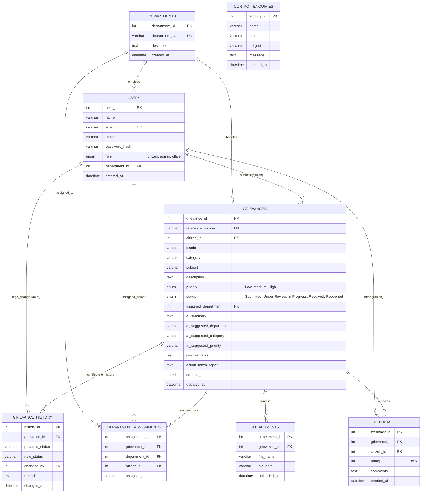

# 03. Database Design

## CM KERALA – Chief Minister's Public Grievance Redressal Portal
**Database Engine:** MySQL Server 8.0+  
**Database Name:** `cm_kerala_portal`  
**Character Set:** `utf8mb4` | **Collation:** `utf8mb4_unicode_ci`  

---

## 1. Entity-Relationship (ER) Diagram

---

## 2. Table Specifications & Data Dictionaries

### Table 1: `departments`
Stores government departments participating in grievance redressal.
| Column | Type | Constraints | Description |
| :--- | :--- | :--- | :--- |
| `department_id` | INT | AUTO_INCREMENT, PRIMARY KEY | Unique department identifier |
| `department_name` | VARCHAR(150) | NOT NULL, UNIQUE | Full official name of the department |
| `description` | TEXT | NULL | Jurisdiction, responsibilities, and scope |
| `created_at` | DATETIME | DEFAULT CURRENT_TIMESTAMP | Timestamp of department creation |

### Table 2: `users`
Stores credentials and profiles for Citizens, CMO Admins, and Department Officers.
| Column | Type | Constraints | Description |
| :--- | :--- | :--- | :--- |
| `user_id` | INT | AUTO_INCREMENT, PRIMARY KEY | Unique user ID |
| `name` | VARCHAR(120) | NOT NULL | User's full name |
| `email` | VARCHAR(120) | NOT NULL, UNIQUE | User login email address |
| `mobile` | VARCHAR(20) | NOT NULL | 10-digit Indian phone number |
| `password_hash` | VARCHAR(255) | NOT NULL | Werkzeug PBKDF2 hashed password |
| `role` | ENUM | NOT NULL, DEFAULT 'citizen' | User role: `'citizen'`, `'admin'`, `'officer'` |
| `department_id` | INT | NULL, FK &rarr; departments | Department affiliation (officers only) |
| `created_at` | DATETIME | DEFAULT CURRENT_TIMESTAMP | Account creation timestamp |

### Table 3: `grievances`
Core entity tracking public grievances and their lifecycle state.
| Column | Type | Constraints | Description |
| :--- | :--- | :--- | :--- |
| `grievance_id` | INT | AUTO_INCREMENT, PRIMARY KEY | Internal primary key |
| `reference_number` | VARCHAR(32) | NOT NULL, UNIQUE | Public tracking number (e.g., `KL-2026-PWD-8401`) |
| `citizen_id` | INT | NOT NULL, FK &rarr; users | Submitting citizen ID |
| `district` | VARCHAR(80) | NOT NULL | One of the 14 Kerala districts |
| `category` | VARCHAR(100) | NOT NULL | Sector category of the complaint |
| `subject` | VARCHAR(255) | NOT NULL | Brief summary title of grievance |
| `description` | TEXT | NOT NULL | Full narrative description |
| `priority` | ENUM | NOT NULL, DEFAULT 'Medium' | `'Low'`, `'Medium'`, `'High'` |
| `status` | ENUM | NOT NULL, DEFAULT 'Submitted' | Exact 5 statuses: `Submitted`, `Under Review`, `In Progress`, `Resolved`, `Reopened` |
| `assigned_department` | INT | NULL, FK &rarr; departments | Routed department ID |
| `ai_summary` | TEXT | NULL | Summary generated by Google Gemini |
| `ai_suggested_department` | VARCHAR(150) | NULL | Gemini AI suggested department |
| `ai_suggested_category` | VARCHAR(100) | NULL | Gemini AI suggested category |
| `ai_suggested_priority` | VARCHAR(20) | NULL | Gemini AI recommended priority |
| `cmo_remarks` | TEXT | NULL | Administrative directives from Chief Minister's Office |
| `action_taken_report` | TEXT | NULL | Field resolution report from assigned department |
| `created_at` | DATETIME | DEFAULT CURRENT_TIMESTAMP | Submission timestamp |
| `updated_at` | DATETIME | DEFAULT CURRENT_TIMESTAMP ON UPDATE | Last modification timestamp |

### Table 4: `grievance_history`
Verifiable audit log recording every single status change in the system.
| Column | Type | Constraints | Description |
| :--- | :--- | :--- | :--- |
| `history_id` | INT | AUTO_INCREMENT, PRIMARY KEY | History record ID |
| `grievance_id` | INT | NOT NULL, FK &rarr; grievances | Reference to grievance |
| `previous_status` | VARCHAR(50) | NULL | Status prior to change |
| `new_status` | VARCHAR(50) | NOT NULL | Newly applied status |
| `changed_by` | INT | NOT NULL, FK &rarr; users | Actor who performed the transition |
| `remarks` | TEXT | NULL | Reason, inspection notes, or directive |
| `changed_at` | DATETIME | DEFAULT CURRENT_TIMESTAMP | Timestamp of status transition |

### Table 5: `department_assignments`
Tracks assignment history of complaints to specific departments and officers.
| Column | Type | Constraints | Description |
| :--- | :--- | :--- | :--- |
| `assignment_id` | INT | AUTO_INCREMENT, PRIMARY KEY | Unique assignment record |
| `grievance_id` | INT | NOT NULL, FK &rarr; grievances | Related grievance |
| `department_id` | INT | NOT NULL, FK &rarr; departments | Assigned department |
| `officer_id` | INT | NULL, FK &rarr; users | Assigned specific officer |
| `assigned_at` | DATETIME | DEFAULT CURRENT_TIMESTAMP | Timestamp of assignment |

### Table 6: `attachments`
Stores paths and metadata for citizen and officer uploaded supporting files.
| Column | Type | Constraints | Description |
| :--- | :--- | :--- | :--- |
| `attachment_id` | INT | AUTO_INCREMENT, PRIMARY KEY | Attachment ID |
| `grievance_id` | INT | NOT NULL, FK &rarr; grievances | Related grievance |
| `file_name` | VARCHAR(255) | NOT NULL | Sanitized unique filename on disk |
| `file_path` | VARCHAR(255) | NOT NULL | Relative path within `uploads/` folder |
| `uploaded_at` | DATETIME | DEFAULT CURRENT_TIMESTAMP | Upload timestamp |

### Table 7: `feedback`
Captures citizen rating and evaluation comments once a grievance is resolved.
| Column | Type | Constraints | Description |
| :--- | :--- | :--- | :--- |
| `feedback_id` | INT | AUTO_INCREMENT, PRIMARY KEY | Feedback ID |
| `grievance_id` | INT | NOT NULL, FK &rarr; grievances | Related grievance |
| `citizen_id` | INT | NOT NULL, FK &rarr; users | Submitting citizen |
| `rating` | INT | NOT NULL, CHECK (1 &le; rating &le; 5) | Satisfaction rating (1 to 5 stars) |
| `comments` | TEXT | NULL | Citizen review comments |
| `created_at` | DATETIME | DEFAULT CURRENT_TIMESTAMP | Feedback submission timestamp |

### Table 8: `contact_enquiries`
Stores general public enquiries submitted via the public contact form.
| Column | Type | Constraints | Description |
| :--- | :--- | :--- | :--- |
| `enquiry_id` | INT | AUTO_INCREMENT, PRIMARY KEY | Enquiry ID |
| `name` | VARCHAR(120) | NOT NULL | Enquirer's name |
| `email` | VARCHAR(120) | NOT NULL | Contact email address |
| `subject` | VARCHAR(200) | NOT NULL | Query subject |
| `message` | TEXT | NOT NULL | Detailed message |
| `created_at` | DATETIME | DEFAULT CURRENT_TIMESTAMP | Timestamp of submission |

---

## 3. Database Indexes for Query Optimization
To ensure rapid search and filter operations across large grievance volumes, the following indexes are configured:
- `grievances(reference_number)`: Instant unique reference lookups on public tracking.
- `grievances(status)`: Accelerates dashboard status counters and filter queries.
- `grievances(district)`: Powers district-wise aggregation and filtering.
- `grievances(assigned_department)`: Guarantees fast loading for department officer dashboards.
- `grievance_history(grievance_id)`: Rapid chronological timeline construction.
- `users(email)`: Instant lookup during login credential verification.
