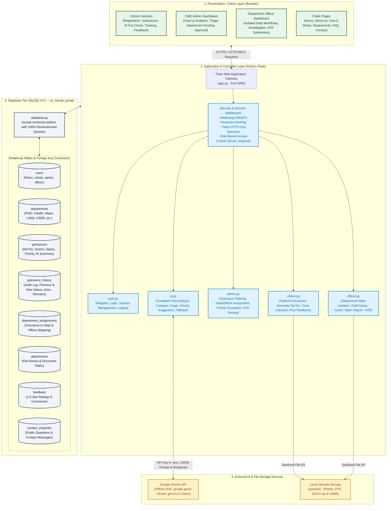
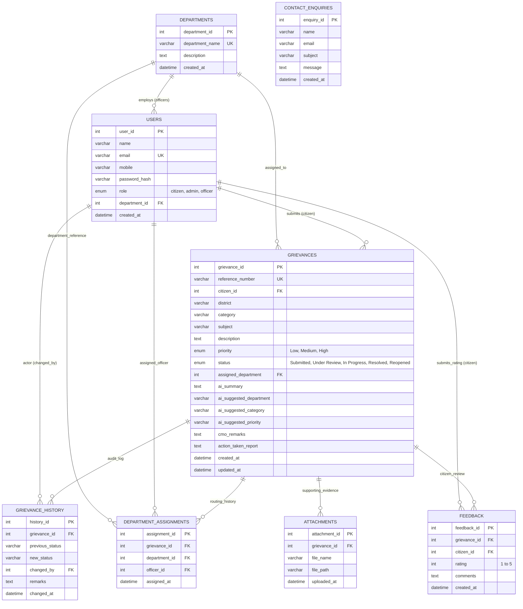
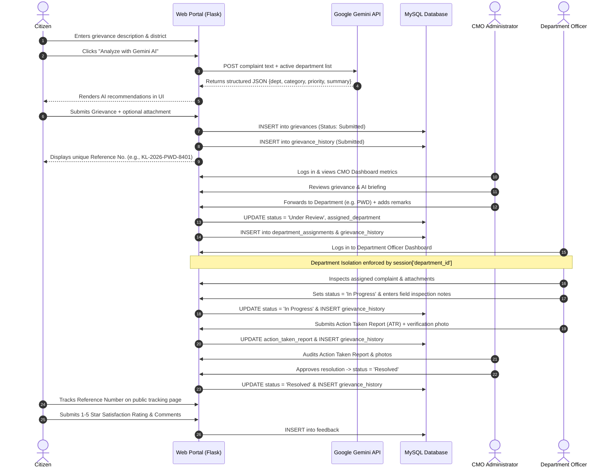
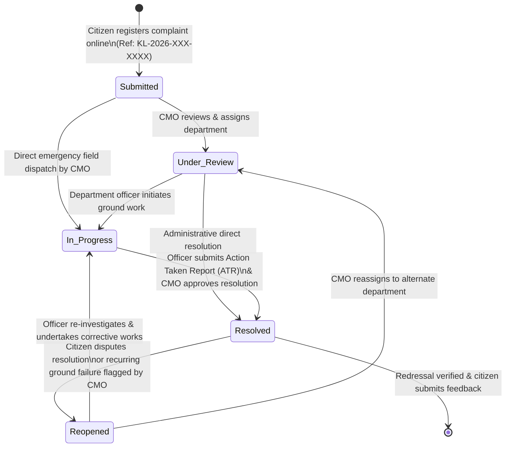
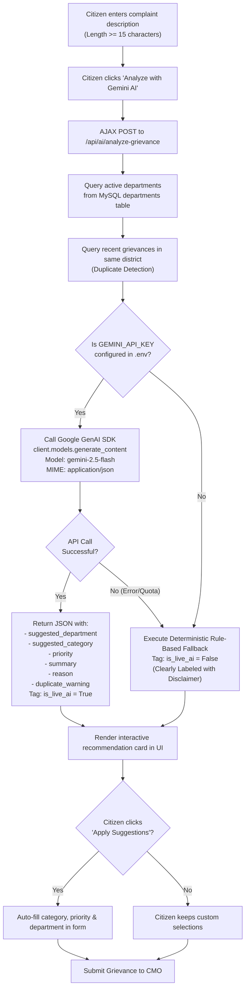

# 08. Required Project Diagrams

## CM KERALA – Chief Minister's Public Grievance Redressal Portal
**Assessment:** WhiteMatrix Software Solutions – AI Full Stack Engineer Machine Test  
**Prototype Year:** 2026  

This document consolidates all mandatory system and database architecture diagrams in standard Mermaid format for technical evaluation and interview presentation.

---

## 1. High-Level System Architecture Flowchart
Illustrates the 4-tier architecture comprising the Client Presentation Layer, Flask Application/Controller Layer, External AI & File Services, and the MySQL Database Tier.

---

## 2. Database Entity-Relationship (ER) Diagram
Defines the 8 relational tables in MySQL, their primary keys (PK), foreign keys (FK), unique constraints, and cardinalities.

---

## 3. End-to-End Grievance Workflow Sequence Diagram
Tracks the interaction across all actors and components from citizen complaint submission through AI triage, CMO administrative assignment, officer field work, resolution approval, and feedback.

---

## 4. Grievance State Machine Diagram
Illustrates the exact 5 grievance statuses and allowable state transitions recorded in `grievance_history`.

---

## 5. AI Grievance Assistant Decision Flowchart
Shows how the asynchronous AI triage evaluates user inputs, validates them against MySQL departments, queries similar cases, calls Google Gemini, and falls back gracefully when needed.

